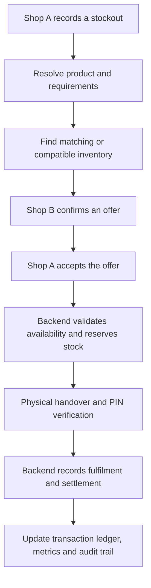
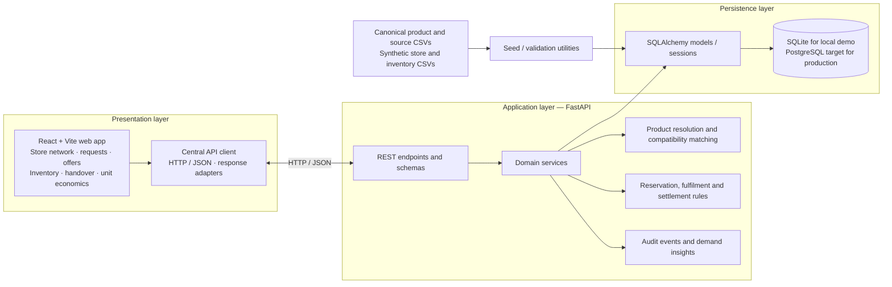

<div align="center">


<a href="https://git.io/typing-svg">
  
</a>

<br/>

[](https://react.dev/)
[](https://vite.dev/)
[](https://fastapi.tiangolo.com/)
[](https://www.python.org/)
[](https://www.sqlalchemy.org/)

<br/>

**A hyperlocal inventory coordination network for independent electronics retailers.**

*Find nearby inventory. Coordinate an offer. Reserve stock. Verify handover. Track the outcome.*

</div>

> **Project status:** Local demo / hackathon implementation. The current seed network is synthetic, inventory is illustrative, and production deployment—especially multi-worker PostgreSQL concurrency and real merchant/POS integrations—requires additional validation.

## ✨ At a glance

<table>
  <tr>
    <td align="center" width="33%">
      <br/>
      <strong>Capture demand</strong><br/>
      <sub>Record the sale that would otherwise be lost.</sub>
    </td>
    <td align="center" width="33%">
      <br/>
      <strong>Match local stock</strong><br/>
      <sub>Find nearby stores with eligible inventory.</sub>
    </td>
    <td align="center" width="33%">
      <br/>
      <strong>Complete the loop</strong><br/>
      <sub>Reserve, verify, settle, and audit.</sub>
    </td>
  </tr>
</table>

ShelfBridge helps a retailer recover a sale when an item is out of stock by finding nearby shops with matching or compatible inventory, coordinating a supplier offer and stock reservation, verifying handover, and recording the resulting transaction economics.

> **Project status:** Local demo / hackathon implementation. The current seed network is synthetic, inventory is illustrative, and production deployment—especially multi-worker PostgreSQL concurrency and real merchant/POS integrations—requires additional validation.

## Table of contents

- [Why ShelfBridge](#why-shelfbridge)
- [How it works](#how-it-works)
- [System architecture](#system-architecture)
- [Key capabilities](#key-capabilities)
- [Technology stack](#technology-stack)
- [Data model and demo dataset](#data-model-and-demo-dataset)
- [Run locally](#run-locally)
- [Validation and tests](#validation-and-tests)
- [API documentation](#api-documentation)
- [AMD benchmark notes](#amd-benchmark-notes)
- [Current limitations](#current-limitations)
- [Repository layout](#repository-layout)

## 🚀 Why ShelfBridge

Independent retailers can lose a sale when a requested product is unavailable locally, even if another shop nearby has it in stock. ShelfBridge turns that stockout into a coordinated local transaction:

1. Capture the unmet demand.
2. Resolve the requested item and find eligible supplier inventory.
3. Confirm an offer from a nearby shop.
4. Reserve stock through the backend.
5. Verify physical handover.
6. Record settlement and the commercial outcome.

The goal is not merely to show nearby stock. It is to manage the transaction lifecycle while keeping inventory and settlement state on the server.

## 🔄 How it works




The backend is authoritative for requests, offers, reservations, fulfilment and settlement. Frontend state is a view of API data; it must not invent successful transaction IDs, reservations, or financial outcomes when the API fails.

## 🧩 System architecture



### Architecture principles

- **Backend-authoritative business state:** the API owns persisted transaction state; the browser renders and submits actions.
- **Deterministic transaction rules:** explicit validation governs stock availability, reservation conflicts, PIN checks and settlement.
- **Product resolution before matching:** identifiers and structured product attributes are used to distinguish exact matches from alternatives. Electrical compatibility should be governed by explicit rules, not left to a generative model.
- **Traceable financial outcomes:** actual settlement records are separate from catalogue MRP estimates and hypothetical projections.
- **Visible failure states:** API errors should be displayed; the frontend must not silently substitute mock stores or catalogue records.

## ⚡ Key capabilities

- **Demand capture:** record a stockout request and its required quantity/specifications.
- **Product catalogue and matching:** resolve products using identifiers and structured attributes, then find candidate inventory.
- **Supplier offers:** create and accept offers for stock transfers between stores.
- **Reservation lifecycle:** reserve available stock, cancel or expire a reservation, and reject conflicting operations with HTTP `409 Conflict` where applicable.
- **Verified fulfilment:** complete a handover using a backend-validated handover code/PIN.
- **Settlement:** calculate total GMV, transfer cost, per-order logistics, platform fee and retailer margin.
- **Price provenance:** distinguish actual settled sale prices from catalogue MRP estimates and unavailable prices. An explicitly supplied non-positive price is rejected; omitting the optional actual price uses the documented catalogue-retail-price fallback.
- **Audit and demand views:** record state transitions and show demand-related insights.
- **Operational inventory tools:** inspect network inventory, adjust stock and onboard stores through backend APIs.
- **AMD benchmark view:** inspect the project's local benchmark path and the execution backend reported by the application.

## 🛠️ Technology stack

| Layer | Technology |
|---|---|
| Frontend | React, Vite, JavaScript |
| Backend API | Python, FastAPI, Pydantic |
| Persistence | SQLAlchemy; SQLite for local testing/demo |
| Production database direction | PostgreSQL (multi-worker locking requires live validation) |
| Tests | pytest, Node.js browser scripts, Puppeteer/Edge for browser acceptance where configured |
| Data inputs | CSV catalogue, product-source provenance, synthetic stores and inventory |
| Local benchmark | ONNX-based synthetic benchmark with CPU execution and optional accelerator path where supported |

## 🗂️ Data model and demo dataset

The core entities represented by the application include:

- **Store:** retailer identity and neighbourhood/location metadata.
- **Product:** SKU/barcode, brand, model, category and structured attributes.
- **Inventory item:** store/product relationship, on-hand quantity, reserved quantity and commercial prices.
- **Demand request:** unmet customer demand and request status.
- **Match candidate / supplier offer:** products and stores proposed to fulfil a request.
- **Reservation / fulfilment:** stock hold, handover details and fulfilment state.
- **Transaction outcome:** recorded GMV, transfer amount, logistics, platform fee and retailer margins.
- **Audit event:** record of relevant business-state changes.

The seeded demo represents four **synthetic** shops in Nehru Place, New Delhi. The reported canonical seed includes 36 product records, 36 product-source records, 21 inventory records, and four demo demand requests. Store inventory and example transaction economics are illustrative—not live stock or retailer-reported sales. Product-source URLs are provenance references; validate individual specifications with the linked source before using the catalogue as an operational source of truth.

Available data utilities:

```powershell
python -m backend.validate_catalogue
python -m backend.seed --reset
```

Use `--reset` only when you intend to reset the local demo database. Confirm the seeder's behaviour in `backend/seed.py` before running it against any database that contains data you need to preserve.

## 💻 Run locally

These instructions assume a Windows development environment and that Python and Node.js/npm are installed. Use the project's current dependency files as the source of truth.

### 1. Create the Python environment

From the repository root:

```powershell
python -m venv .venv
.\.venv\Scripts\Activate.ps1
python -m pip install --upgrade pip
pip install -r requirements.txt
```

If the project dependencies are maintained differently in your checkout, follow the current `requirements.txt` and README/setup instructions in the repository.

### 2. Start the backend

From the repository root:

```powershell
python -m uvicorn backend.main:app --reload --host 127.0.0.1 --port 8000
```

FastAPI's interactive API documentation is normally available at:

- `http://127.0.0.1:8000/docs`
- `http://127.0.0.1:8000/openapi.json`

Use `/docs` to confirm the routes exposed by the exact version of the backend you are running.

### 3. Seed the local demo data

In a second terminal at the repository root:

```powershell
.\.venv\Scripts\Activate.ps1
python -m backend.validate_catalogue
python -m backend.seed --reset
```

The `--reset` operation may replace/reset local demo data. Run it only against the intended local development database.

### 4. Start the frontend

In another terminal:

```powershell
cd Frontend
npm install
npm run dev
```

Open the local URL printed by Vite, usually `http://localhost:5173`. The frontend API client expects the backend to be reachable at its configured base URL; check `Frontend/src/api/client.js` if you change the backend host or port.

### 5. Build the frontend

From `Frontend/`:

```powershell
npm run build
```

The production build is written to `Frontend/dist/`. The repository should follow one consistent deployment strategy: either publish the complete generated build artifact or build from source as part of deployment. Do not deploy a tracked `index.html` whose hashed JavaScript/CSS assets are absent.

## 🧪 Validation and tests

Run these checks from the repository root unless noted otherwise.

### Backend and data validation

```powershell
python -m pytest tests/ -v
python -m backend.validate_catalogue
python -m tests.verify_phase1_2
python -m tests.verify_live_transaction
```

### Frontend regression and browser tests

Start the backend and frontend first where a test needs a live server. Then run from `Frontend/`:

```powershell
node tests_browser/test_financial_integrity.cjs
node tests_browser/test_fix1_lifecycle.cjs
node tests_browser/test_negotiated_price_handover.cjs
node tests_browser/run_acceptance_suite.cjs
```

The browser acceptance suite exercises the main transaction flow, persistence across reload, invalid and valid handover codes, reservation expiry, settlement reporting and concurrent stock contention. Browser tests may require Microsoft Edge and the browser automation dependencies configured in the project.

The latest project report supplied for this README recorded **22 passing backend tests** and passing financial-integrity, lifecycle, negotiated-price and full browser acceptance suites. These are reported results from the development workspace, not a guarantee that tests pass in every environment. Re-run the commands above after pulling or modifying the code.

## 🔌 API documentation

The FastAPI OpenAPI specification is the authoritative reference for the API routes, request schemas, response schemas and status codes. Start the backend and inspect `http://127.0.0.1:8000/docs`.

Important API areas include stores, products, inventory, demand requests, matching, supplier offers, reservations, fulfilments, settlement summaries, audit events and demand insights. The audit route is available under both `/api/audit-events` and `/api/audit-logs` in the reported implementation.

### Important business semantics

- **Available quantity:** on-hand quantity minus reserved quantity, bounded at zero.
- **Stock conflicts:** rejected stock/state conflicts use HTTP `409 Conflict` in the implemented paths.
- **Invalid handover / invalid explicit sale price:** HTTP `400 Bad Request` under the reported API contract.
- **Settlement price input:** `actual_customer_price_per_unit` is a per-unit amount; total GMV is per-unit price multiplied by reserved quantity.
- **Legacy compatibility:** `actual_customer_price` is retained as a legacy alias. If both aliases are supplied with different values, the reported implementation rejects the request.
- **Omitted sale price:** if neither field is supplied, catalogue retail price is used by the documented fallback. This is a defaulting rule, not proof that the customer negotiated or paid that exact price.
- **Logistics:** the current settlement rule models logistics as a flat per-order charge.
- **Platform fee:** the current settlement rule is `max(₹25, 2.5% of total GMV)`.

## 🧠 AMD benchmark notes

ShelfBridge includes a local AMD-oriented benchmark path. Interpret its results narrowly:

- The benchmark uses a synthetic ONNX graph, not an end-to-end measure of real-world product matching or transaction throughput.
- CPU performance and the selected execution provider should be reported separately.
- The development reports indicate that the DirectML path fell back to CPU on the tested machine because a compatible D3D12 device was not detected.
- Therefore, do **not** describe the current result as proven GPU acceleration. The selected execution backend and fallback status should be checked in the live application output.

## ⚠️ Current limitations

- **Synthetic inventory:** seeded stock, store identities and demo transactions are illustrative. Real availability requires merchant input, POS integration or a verified inventory feed.
- **PostgreSQL concurrency:** current contention verification used SQLite (WAL/busy-timeout and application-level synchronization as implemented). Multi-process or multi-node production contention has not been verified against a live PostgreSQL deployment with row-level locks.
- **Real-time updates:** the current implementation relies on API operations/refetching; production-grade cross-client push updates (for example, SSE or WebSockets) are not established by the current tests.
- **Product data verification:** catalogue-source links are provenance aids. Confirm exact model numbers, barcode mappings, electrical specifications and commercial terms before production use.
- **Settlement model:** platform fee, logistics and transfer assumptions are demo business rules and should be confirmed with real retailer pilots before being treated as final commercial policy.
- **Security and operations:** before a production launch, review authentication/authorization, secrets management, rate limiting, observability, backups, migrations, privacy, and audit retention.

## 📁 Repository layout

```text
.
├── README.md
├── requirements.txt
├── backend/
│   ├── main.py                  # FastAPI routes
│   ├── models.py                # SQLAlchemy data models
│   ├── schemas.py               # Pydantic request/response schemas
│   ├── services.py              # Domain rules and transaction lifecycle
│   ├── seed.py                  # Demo data seeding utility
│   ├── validate_catalogue.py    # Canonical data validation
│   └── amd_engine.py            # Local benchmark path
├── data/
│   ├── canonical/               # Product catalogue and source references
│   └── seed/                    # Synthetic stores and inventory
├── Frontend/
│   ├── src/
│   │   ├── api/                 # Central frontend API client
│   │   └── App.jsx
│   ├── tests_browser/           # Browser regression / acceptance scripts
│   └── package.json
└── tests/                       # Backend tests and integration checks
```

Some files may differ by branch or local working-tree state; use `git status` and the actual repository tree to confirm the layout.

## 🤝 Contributing and development hygiene

- Keep business state and settlement calculations backend-authoritative.
- Do not replace API failures with fake success responses or fabricated records.
- Keep MRP estimates distinct from realised customer sale prices.
- Add regression tests for changes to stock availability, reservation transitions, handover validation or settlement maths.
- Run `git diff --check` and the relevant test suites before committing.
- Keep local databases, virtual environments, credentials and transient cache/build files out of commits unless they are explicitly part of the project's chosen deployment strategy.

## 📄 License

No license is specified in this README. Add a `LICENSE` file and update this section before distributing the project as open source.

---

<div align="center">


<sub>Built to help independent retailers turn local availability into completed transactions.</sub>

</div>
